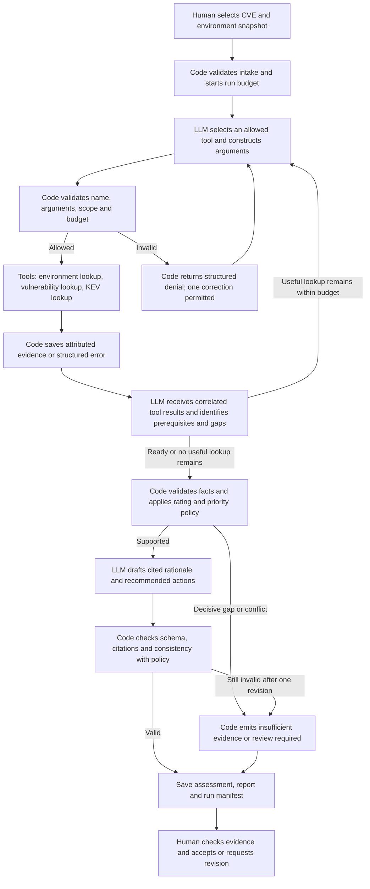

# Step 1 Security Triage Agent Design

**Case:** CVE-2024-21762 in Northbridge Services' FortiOS VPN gateways  
**Status:** Design approved for implementation; policy and controlled replay tests implemented. Real-model execution and human review are recorded separately in run artifacts.  
**Members:** Atharva Ashish Jog, Varun Bhanushali, Shweta Mittal, Deekshitha Manjunatha Reddy. 

We propose one agent that gathers attributed environment and threat evidence, compares exploit prerequisites with local facts, and produces a policy-supported High, Medium, or Low risk rating plus a separate response priority, or an explicit Insufficient evidence / Review status. The original scenario cannot establish vulnerability because gateway firmware and SSL-VPN configuration are unknown. We will retain this uncertainty and use separate, labeled simulated variants for a positive demonstration and policy checks.

This document revises the five Week 3 Design Studio responses for Assignment 3. The supplied studio PDF includes Atharva's Team 2 Alert Prioritization worksheet on PDF pages 12–15. We retain its chaining pattern, direct tools, bounded retries, validation, and analyst review, while replacing SIEM prioritization with a CVE applicability and business-impact assessment. Studio team membership is not assumed to be Assignment 3 project membership.

## 1 System contract

### Task and risk question

Assess whether CVE-2024-21762 can affect the N02 remote-access VPN gateway pair in the selected environment snapshot, what consequences exploitation could have for Northbridge's services, and what the analyst should do next.

The external case is a FortiOS vulnerability involving unauthorized remote code execution. Fortinet's CNA record provides product-specific version ranges and fixes [E1]; CERT-EU describes the SSL-VPN component and unauthenticated attack [E2]; CISA records known exploitation [E3]. This makes a relevant case for N02 without establishing that Northbridge has been compromised.

### Input scope and environment

Inputs are the CVE ID, saved external case evidence, a versioned local environment snapshot, and policy version. The model receives the selected asset and relevant context, rather than arbitrary project files.

| Item | Evidence in the supplied DOCX | Interpretation or limitation |
| --- | --- | --- |
| N02 | Two Fortinet FortiGate 100F gateways running FortiOS, active/standby at HQ | Direct assessment target; cohort evidence does not establish identical firmware or configuration on each member |
| Firmware | Precise appliance firmware is unknown | Preserve null; do not infer an affected version |
| VPN service | Public VPN endpoint 192.0.2.20:443; DMZ and authenticated VPN address pool | Public VPN service is stated; the document does not explicitly identify SSL-VPN or prove which process terminates that endpoint |
| Access policy S02 | Unlisted inter-zone traffic denied; no public RDP, SMB, LDAP, SQL, or management interfaces | Preserve segmentation; public VPN exposure does not prove direct database or Tier 0 access |
| Business context | 1,000 employees, including 150 remote staff; customer service, orders, invoicing, payroll | Remote-access outage or gateway compromise could affect production work; impact reasoning must state its assumptions |
| Telemetry S04 | VPN, firewall, identity, and Microsoft 365 logs retained online for 90 days | Supports recommending review of existing logs; no log events are supplied to prove compromise |
| Impact S05 | Service consequences and recovery targets | Do not assign a VPN-specific RTO: none is supplied |

All environment evidence has `source_mode: simulated`. N01 is Palo Alto infrastructure and is not a directly affected FortiOS asset. Windows servers are possible downstream business dependencies, not direct CVE matches. MFA is not proof that an unauthenticated appliance vulnerability is mitigated.

The DOCX names `windows_enterprise_environment.json`, `asset_inventory.csv`, `evidence_register.json`, and `lookup_environment.py`, but these companion files are absent from the current project. After approval, derive a minimal, attributed JSON snapshot from the DOCX. Label it as a derived teaching snapshot, preserve unknowns, and do not invent the referenced sixteen flow records, individual gateway names, evidence dates, or permissions. If companion files become available, reconcile them and record the change.

### Required assessment output

Produce a structured JSON assessment and a readable Markdown report. Required fields:

- `run_id`, assessment time, `asset_id`, cohort/instance scope, `threat_id`, snapshot hash, and policy version.
- `status`: `rated`, `insufficient_evidence`, or `review_required`; `rating`: `High`, `Medium`, `Low`, or null.
- `priority`: `Critical`, `High`, `Medium`, `Low`, `Informational`, `Insufficient evidence`, or `Review`. Missing decisive evidence maps to `insufficient_evidence` / null rating / `Insufficient evidence` priority; unresolved decisive conflicts map to `review_required` / null rating / `Review` priority.
- Applicability state, each prerequisite's true/false/unknown/conflicting value, supported attack path, Internet reachability of the vulnerable component, impact level and consequences, policy rule ID, and rationale. Attach evidence references to each decisive policy input.
- Evidence IDs, source URLs or document locators, facts, publication/update/retrieval dates where available, source mode, and saved artifact references.
- Facts separated from assumptions and unknowns; qualitative confidence with reasons, not an invented probability.
- Recommended actions, proposed owner, urgency, and evidence that would change or resolve the decision.
- Human review state and actual reviewer/decision when review occurs; tool failures and material limitations.

An illustrative baseline decision, not an executed result:

```json
{
  "asset_id": "N02",
  "threat_id": "CVE-2024-21762",
  "status": "insufficient_evidence",
  "rating": null,
  "priority": "Insufficient evidence",
  "applicability": "unknown",
  "attack_path": "unknown",
  "internet_reachable": null,
  "policy_rule": "R6",
  "environment_source_mode": "simulated",
  "unknowns": [
    "Firmware version on each gateway",
    "Whether SSL-VPN is enabled on each gateway",
    "Whether the public endpoint reaches the affected SSL-VPN component"
  ],
  "recommended_action": "Obtain dated firmware and SSL-VPN configuration evidence for both gateways and verify the service mapping, then reassess.",
  "human_review": "pending"
}
```

## 2 Workflow and human role

### Architecture and model

Use **one tool-calling agent within a chaining workflow**, implemented as a small Python application with separately identifiable source adapters, tool contracts, orchestration, policy, and validation modules. No multi-agent system or MCP server is needed for three fixed read-only integrations.

Selected model service: Duke AI Gateway, as requested by the group during implementation. Use a configurable tool-capable model ID, with `GPT 4.1` as the default from Duke's developer guide, temperature zero, bounded context, and the provider-reported model ID recorded. Local Ollama was the initial proposal but was unavailable. Cloud model weights/digests are not exposed by the gateway; preserve the reported model ID and response usage instead. A scripted/offline model supports tests but cannot replace the required real model-driven complete run.



The model must actually choose at least one tool/query. Code executes that request, associates the result with its tool-call ID, and returns it to the model. A qualifying complete run must include an executed environment lookup and an executed relevant external lookup that contribute to the assessment. The host checks this requirement; an answer from model memory alone is not a complete demonstration.

Code computes version matches and the final rating and priority under the same policy rule. The model explains cited evidence and proposes actions. Model-proposed facts must resolve to evidence; unsupported or conflicting decisive claims cannot enter the policy engine as confirmed facts. Impact categorization follows explicit criteria and records its evidence and assumptions; the analyst reviews this judgment.

### Rating and priority policy version 2

The policy assesses risk from this specific CVE in the declared snapshot, not total organizational security. Technical severity, local impact, applicability, confidence, and response priority remain distinct. Priority identifies the response category: both R1 and R2 produce a High risk rating, but supported Internet reachability makes R1 Critical priority. Critical is a priority value, not a fourth risk rating.

**Applicability prerequisites:** matching product/component, an affected firmware version, and SSL-VPN enabled. Assess the attack path separately: identify the threat source, reachable vulnerable component, and permitted route in the declared scenario. Internet reachability must refer to that component, not merely an unrelated public service on the asset. Compare numeric version tuples within the correct product and release branch. An unrecognized version/build or unsupported branch is unknown, not automatically unaffected. For the planned version-boundary test, FortiOS 7.2.6 is within the affected range and 7.2.7 is a fixed release for this CVE [E1]. This is a historical test boundary, not a recommendation to deploy that old release today.

- `confirmed`: every required prerequisite is supported and true.
- `not_applicable`: reliable scoped evidence disproves at least one necessary prerequisite. State whether this is a fixed version, absent component, or verified disabled service. An affected but disabled component still needs patch planning; Low does not mean permanently safe.
- `unknown`: no prerequisite is decisively disproved, and at least one decisive fact is missing.
- `conflicting`: unresolved credible evidence disagrees on a decisive prerequisite. Preserve both records and their dates.

Record attack-path support and Internet reachability independently as supported/absent/unknown/conflicting and true/false/unknown/conflicting respectively. Lack of Internet exposure does not rule out a supported internal attack path. A failed lookup or unknown route does not prove that no attack path exists. If verified absence of every path in the declared scope is used as a decisive absent prerequisite under R5, cite the evidence that establishes that bounded absence.

**Impact criteria, assuming exploitation succeeds:**

| Impact | Criteria |
| --- | --- |
| High | Compromise or material interruption of production remote access, sensitive financial/customer data, critical identity/recovery services, or a supported path affecting such services |
| Medium | Material interruption or disclosure affecting a bounded noncritical team/service, with evidenced separation from sensitive production services and limited recovery consequences |
| Low | Disposable or isolated test workload with synthetic data, no sensitive credentials, no production dependencies, and negligible operational consequences |
| Unknown | Evidence cannot establish the relevant business use or distinguish consequence levels |

For N02, production remote-access role supports a proposed High impact classification based on operational interruption and gateway trust. The 150 remote staff are context, not proof that all 150 simultaneously depend on this VPN. Do not claim domain takeover, direct SQL reachability, actual data loss, or a proven outage duration. Label this impact judgment and its assumptions for analyst review. Unknown downstream paths remain unknown; they do not automatically defeat an independently supported impact consequence.

The group's revised rules are:

| Rule | Evidence-supported conditions | Decision | Priority |
| --- | --- | --- | --- |
| R1 | Vulnerability applies, the vulnerable service is Internet reachable, and compromise could cause major business consequences | High | Critical |
| R2 | Vulnerability applies through a supported attack path and could cause major consequences, but R1 is not met | High | High |
| R3 | Vulnerability applies through a supported attack path and consequences are limited to a service or small user group | Medium | Medium |
| R4 | Vulnerability applies, but supported consequences are minor and confined to a low-value, isolated service | Low | Low |
| R5 | Evidence confirms a decisive prerequisite is absent, such as an unaffected version or disabled vulnerable component | Low | Informational |
| R6 | Missing or conflicting evidence prevents determining applicability, attack path, or impact | Insufficient evidence / Review | Insufficient evidence / Review |

Implementation precedence: validate evidence scope and integrity first; a validation failure produces Review with a distinct validation reason, not a claim that a risk rule was satisfied. A supported absent prerequisite with no unresolved conflict in its proof yields R5; unknown unrelated facts do not prevent that scoped result. Otherwise, missing or conflicting decisive applicability, attack-path, or impact evidence yields R6. For a supported applicable case, evaluate R1 before R2, then R3 or R4 according to impact. Major consequences map to High impact, limited consequences to Medium, and minor isolated consequences to Low. R4 also requires a supported attack path; isolation describes limited consequences, not an assumption that exploitation is possible.

R2 requires evidence that R1 does not hold: for example, a supported internal attack path and verified absence of Internet reachability. Unknown Internet reachability must not be silently treated as false; if it prevents choosing between Critical and High priority, report R6 and request the decisive exposure evidence. R6 distinguishes missing facts (Insufficient evidence) from unresolved credible contradictions (Review), with null rating in either case.

Known exploitation from KEV informs the recommended response urgency but cannot establish local firmware/configuration or overwrite the rule-assigned rating or priority. A KEV miss is not evidence of safety. CVSS is reported with its original source, vector, and version and is not copied into the local risk rating or priority. Conflicting severity metadata is disclosed; it is decisive only if the policy uses it, which this policy does not.

**Why this policy:** consequence-based ratings are simple to implement and test, while a separate priority distinguishes Internet-reachable major-impact cases from other supported major-impact paths. Applicability gates prevent a product-name match from becoming a vulnerability finding. The explicit unknown/conflict states prevent arbitrary Medium or Low defaults. Low / Low retains an applicable minor-impact vulnerability; Low / Informational records a supported absent prerequisite. An Internet-exposed production VPN cannot qualify as a disposable test workload.

### Human review and recommended actions

The group analyst verifies the saved source excerpts, dates, asset scope, rule, risk rating, priority, supported attack path, impact justification, unknowns, and recommended actions. Record review separately from agent completion. Never fabricate acceptance or consensus.

- Original baseline: request firmware and SSL-VPN status for both gateway members, endpoint/service mapping, configuration dates, and permitted access paths. Flag this as an urgent evidence request because known exploitation is reported externally.
- High / Critical (R1): recommend immediate analyst attention and prompt upgrade through the vendor-supported path to a currently supported fixed release, coordinated across both gateways; review VPN/firewall/identity logs for suspicious activity. A temporary SSL-VPN restriction or disablement requires verified vendor guidance and analyst/change-owner approval because remote access can be interrupted.
- High / High (R2): recommend urgent remediation of the supported attack path and affected service, recording why Critical priority does not apply.
- Medium / Medium (R3): recommend a bounded remediation plan with owner and rationale; confirm the limited business consequences.
- Low / Low (R4): retain the applicable vulnerability finding and recommend routine remediation; verify the low-value service's isolation.
- Low / Informational (R5): explain the supported absent prerequisite, retain configuration/version evidence, and identify changes that would require reassessment.
- Insufficient evidence / Review (R6): specify the missing or conflicting fact, assign an evidence-resolution action, and preserve any urgent investigation recommendation separately from the unresolved priority.

The application produces recommendations and local artifacts. Operational patching, network changes, account actions, live scans, and external notifications are outside its tool set. A human would approve any later operational action. Your approval of this design is the gate before implementation in this project.

## 3 Essential tools and evidence flow

Use three direct Python tools with strict JSON argument schemas. The model cannot supply arbitrary paths, URLs, commands, or headers. Exact allowlisted sources are configured by the application.

| Tool | Purpose and accepted input | Output and attribution | Failure and decision role |
| --- | --- | --- | --- |
| `lookup_environment` | Read asset and relevant context; `{asset_id: "N02", snapshot_id: "northbridge-docx-v1"}` | Product, cohort size, nullable versions/configuration, exposure statements, controls, business context; DOCX section/table row and S01/S02/S04/S05 when relevant; snapshot hash; mode simulated | Missing file/schema/scope mismatch stops supported rating. No match is a scoped lookup result, not an absence declaration. Provides local prerequisite and impact facts |
| `lookup_vulnerability` | Obtain affected component, versions, fixes and severity; `{cve_id: "CVE-2024-21762", source: "cna"}`; source enum also permits vendor, NVD and CERT-EU | Saved response, normalized product-specific ranges and prerequisite facts; publisher, URL, JSON pointer or passage locator, publication/update/retrieval dates and mode | Bounded retry; use a verified alternate primary source or labeled cache. If decisive threat facts remain unavailable, Insufficient evidence. Provides threat-side prerequisites |
| `lookup_kev` | Determine reported exploitation context; `{cve_id: "CVE-2024-21762"}` | CISA catalog match, date added, required action, references and retrieval metadata; valid no-match distinct from lookup failure | Retry once; use saved CISA evidence with cache label if available. Otherwise exploitation state unknown. Does not establish non-applicability or override the impact policy |

Vendor/CNA evidence governs product ranges and remediation; CERT-EU can corroborate the component; NVD adds technical-severity context. CISA governs catalog membership. Local scenario evidence governs Northbridge facts. Retain differing source claims rather than merging away disagreement. Do not assume a newer generic secondary source outranks product-specific authoritative evidence.

Each tool returns an envelope containing `tool_call_id`, `status`, evidence IDs, normalized facts with locators, nullable source dates, retrieval time, `source_mode`, artifact hash, and structured error if applicable. External modes are `live` or `cached`; local facts are always `simulated`, with fixture/scenario variant IDs. A saved live response remains attributed to its original retrieval; subsequent offline use is cached. Do not label invented external evidence as live or cached.

Example requests:

```json
{"name":"lookup_environment","arguments":{"asset_id":"N02","snapshot_id":"northbridge-docx-v1"}}
{"name":"lookup_vulnerability","arguments":{"cve_id":"CVE-2024-21762","source":"cna"}}
{"name":"lookup_kev","arguments":{"cve_id":"CVE-2024-21762"}}
```

Keep the source URL plus passage/JSON pointer in the normalized output. Saving a source link alone is insufficient: the cited fact must be verifiable in the saved input. Record missing source dates as null. For reproducible demonstrations, pin the retrieved source revision or hash and save the permitted payload used.

Recorded Future and Tavily are optional examples in the assignment, not requirements. They are not necessary for this case. Avoid an extra paid/credentialed dependency when vendor/CNA and CISA evidence answer the risk question.

### Credential and input controls

- Do not read the separate course API-key PDF into agent context, extraction routines, source control, reports, traces, or demo recordings.
- Any later provider credentials come from environment variables or an ignored local secret file. Commit only configuration names and empty placeholders.
- Exclude `.env`, secret files, the credential-bearing PDF, and credential-bearing intermediates from repository/ZIP packaging. Use a sanitized source allowlist rather than recursively packaging the project.
- Never log authorization headers, secrets, full environment-variable dumps, or unredacted provider exceptions. Secret filtering applies to inputs before logging/model dispatch and to outputs before persistence.
- Treat external text as data. Tool-result instructions cannot modify permissions, invoke shell commands, request credentials, or change the policy. Host validation enforces this boundary.
- Before submission, check the selected source files, saved traces, assessments, and final ZIP for secret patterns and any locally configured credential values without printing those values.

## 4 Failure walkthrough and trace

### Failure scenario

The model requests authoritative affected-version information, but the source times out and no verified cache or alternate evidence is available.

1. Host validates the request and executes it with a ten-second HTTP timeout.
2. Tool returns a structured timeout, not an empty unaffected result. Retry once, with short bounded backoff, within the overall budget.
3. The model receives the correlated failure and may choose an allowed alternate source if budget remains.
4. If threat prerequisites remain unsupported, code applies R6 and saves Insufficient evidence, rating null, priority Insufficient evidence, source failure, and an action to retrieve verified applicability evidence.
5. The analyst reviews the unresolved case. No vulnerability or safety claim is invented to finish the run.

A failed KEV lookup alone may still permit a supported rating if other prerequisite and impact evidence is sufficient, because KEV is not a rating prerequisite. Record reduced exploitation-context confidence. A cached fallback is useful but must be explicitly labeled with age and original retrieval time.

### Enforceable limits and other failure paths

Proposed limits: eight total tool executions including retries and alternates, eight model turns, a 180-second run deadline, ten seconds per HTTP attempt, and thirty seconds per model request. These are runtime limits; timeouts are bounded by the remaining deadline. Duplicate queries without new evidence cannot continue indefinitely.

- Missing firmware, SSL-VPN configuration, decisive attack path, exposure, or impact evidence: do not infer values. Once no authorized evidence source can resolve them within budget, stop investigation with R6 and priority Insufficient evidence.
- Contradictory dated firmware/configuration, attack-path, exposure, or impact evidence: R6 with priority Review until scope/date reconciliation resolves it; do not average versions.
- Invalid tool arguments: reject before execution, return structured feedback, permit one correction; repeated invalid calls stop with Review required.
- Wrong asset/snapshot or cross-scope tool result: reject before adding its payload to model context; stop with Review required and a safe error trace.
- Budget exhaustion: save unresolved status, outstanding gaps, and `stop_reason`; never imply the complete run passed.
- Model outage: preserve evidence and report an explicit execution/review failure. A policy-only result does not count as a demonstrated model-driven run.
- Unsupported rationale or fabricated citation: one bounded revision; if still invalid, Review required with null rating.
- Failure to save required evidence/output: report execution failure; the demonstration checklist cannot pass.

Trace fields: run/step IDs, model/provider and digest, policy/snapshot versions, safe arguments, tool-call correlation ID, attempt number, timestamps/duration, status/error code, evidence IDs/hash/mode, policy inputs/rule, rating, priority, supported attack path, Internet reachability, stop reason, and human review outcome. Record only safe summaries of rejected payloads.

## 5 Success test and testing plan

### Acceptance test

From one selected CVE and one versioned snapshot, run the real model. Verify a model-selected valid tool call is executed and its attributed result returned to the model; both environment and external evidence contribute; the policy produces the expected supported rating and priority or explicit Insufficient evidence / Review; citations resolve; unknowns and modes are preserved; recommended actions address the result; and a group member reviews the assessment.

**Proposed metric:** percentage of end-to-end cases that match the documented expected decision and satisfy all evidence/uncertainty requirements. **Target:** 100% on the small controlled set below. This is a proposed acceptance target, not measured accuracy or a claim of broad generalization.

Set expected results before running. Group members review policy expectations and record actual consensus after discussion. All test changes are explicit overrides to copied scenario variants; keep the original DOCX and baseline snapshot unchanged.

| Case | Controlled input and invariant | Expected result |
| --- | --- | --- |
| Original baseline | N02 as documented; unknown firmware and SSL-VPN configuration | R6; null rating / Insufficient evidence priority; exact missing prerequisites and evidence request |
| Positive complete run | Simulated gateway instance on FortiOS 7.2.6; SSL-VPN enabled and the affected component Internet reachable; production remote-access role with supported major consequences; all additions explicitly labeled | R1; High / Critical; cited version match, operational consequence, unknown downstream reachability retained |
| Applicability change | Change only firmware from 7.2.6 to 7.2.7 in the positive fixture; impact and exposure constant | R1 to R5; High / Critical to Low / Informational; fixed for this CVE, not a declaration that the entire gateway is secure |
| Exposure and priority change | Keep applicability and major impact constant; verify Internet reachability false while retaining an evidenced internal attack path | R2; High / High; rating remains High, priority changes from Critical to High |
| Impact change | Keep affected version, SSL-VPN and Internet-reachable threat path constant; change business context to a bounded noncritical test-team service with evidenced production separation | R3; High / Critical to Medium / Medium; explain changed consequence and separation evidence |
| Low impact extension | Same applicable threat with a supported attack path on a disposable test workload with synthetic data, no sensitive credentials or production dependencies | R4; Low / Low; retain vulnerability fact and limited scope |
| Missing or conflicting evidence | Positive fixture with firmware null; second subcase has incompatible credible records for the same instance/time | R6; null rating / Insufficient evidence for missing version; null rating / Review for unresolved conflict |
| Missing exposure evidence | Applicable vulnerability with a supported internal path and major consequences, but Internet reachability unknown | R6; null rating / Insufficient evidence; do not assume R2, request evidence to distinguish Critical from High priority |
| Controlled tool failure | Threat applicability lookup and all permitted alternatives unavailable, no verified cache; keep environment fixed | Bounded retries, R6, null rating / Insufficient evidence, recorded errors and evidence request |

The required three policy checks are applicability change, impact change, and missing/conflicting evidence. The controlled failure is separate. Also verify that an invalid request causes no tool execution and that KEV failure cannot silently become a negative KEV result.

For every case preserve inputs, overrides, expected and actual status/rating/priority, pass/fail, rule, evidence references, limitations, and reviewer. Actual results remain unfilled until execution. A simulation-only test or scripted model transcript must be labeled and cannot be presented as the real model demonstration.

## Planned implementation and submission artifacts after approval

| Artifact | Contents |
| --- | --- |
| README and dependency/configuration files | Setup, pinned versions, provider/model settings without secrets, complete-run and test commands |
| Design and Week 3 worksheet | This revised five-response design, workflow diagram, tool contracts/examples, six-rule rating and priority policy, and implementation deviations |
| Environment snapshot and variants | DOCX-derived facts, source locators, explicit unknowns, immutable baseline, and test overrides |
| Saved threat evidence | Permitted vendor/CNA/CERT-EU/NVD/CISA inputs with retrieval metadata, locators, hashes, and fallback labels |
| Runnable agent | Provider adapter, model-driven orchestration, guarded tools, deterministic policy, schema/citation validation, safe persistence |
| Assessment and demonstration | JSON and readable report; complete-run checklist; correlated tool request/result evidence; actual human review |
| Testing report | Three policy checks and one controlled failure; expected versus actual results, consensus, limitations |
| Baseline manifest | Inputs, snapshot, policy, prompt/configuration, dependency/model/code versions and outputs for Assignment 4 reuse |
| Contributions and AI disclosure | Actual member work and AI assistance; never inferred contributions |
| Demo video if needed | Required if the group does not present in class; show design, tool calls, rationale, uncertainty and limitations |

The assignment text inconsistently mentions Assignment 2 in the testing/baseline section; the rubric explicitly asks for a baseline for Assignment 4. Preserve the current project's complete baseline and note the course-text inconsistency without inventing a prior Assignment 2 submission.

and is submitted as an instructor-accessible GitHub repository.

## Sources and research limitations

Course sources in the project:

- `Assignment 3_ Build a Security Triage Agent.pdf`, pages 1–4: requirements, deadline, model-driven tool use, submission and 35/45/20 rubric.
- `Windows_Enterprise_Environment.docx`, Organization and scope; Network architecture and access; Endpoints appliances and cloud services; Evidence controls and business impact; Agent integration and assessment practice; N02/S02/S04/S05 table rows.
- `CYBERSEC_590_W3_Design Studio.pdf`, pages 1–2 and 12–15: five responses and Atharva's prior worksheet.
- `590 WK 3 Master.pdf`, pages 11–13 and 33–37: design patterns, unknown outputs, runtime limits and untrusted tool-result instructions.
- `CYBERSEC 590 (511) Class 2 Fall 2026.pdf`, page 102: application executes tool use and returns results to the model.

External sources checked during this design review:

- **E1** [Fortinet CNA record in the official CVE list](https://github.com/CVEProject/cvelistV5/blob/main/cves/2024/21xxx/CVE-2024-21762.json): `containers.cna.affected`, `solutions`, and source-specific metrics. [Raw record](https://raw.githubusercontent.com/CVEProject/cvelistV5/main/cves/2024/21xxx/CVE-2024-21762.json).
- **E2** [CERT-EU Security Advisory 2024-018](https://cert.europa.eu/publications/security-advisories/2024-018/): SSL-VPN attack prerequisite and technical details.
- **E3** [Official CISA KEV data](https://github.com/cisagov/kev-data/blob/main/known_exploited_vulnerabilities.json): entry selected by `cveID == CVE-2024-21762`; reported exploitation, not proof of a Northbridge incident.
- **E4** [Fortinet vendor advisory FG-IR-24-015](https://www.fortiguard.com/psirt/FG-IR-24-015) and [user-selected NVD record](https://nvd.nist.gov/vuln/detail/CVE-2024-21762): intended live sources; their full content was inaccessible through the research tool in this review. No successful retrieval is claimed. E1–E3 supplied the verified case facts; record source failures/fallbacks in the implementation.
- **E5** [Ollama Qwen3 8B model listing](https://ollama.com/library/qwen3:8b): proposed model candidate; local availability and complete tool-use behavior are not yet verified.

No course credentials were read into this design. The implemented workflow, documented deviations and actual controlled test results are in the project artifacts. Real-model execution, human acceptance and operational actions are not inferred from replay results; inspect the relevant run checklist and member review record.
